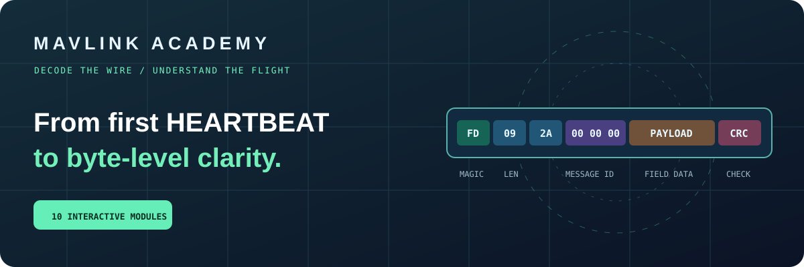

# MAVLink Academy



**A visual, beginner-to-expert learning environment for the MAVLink protocol.** Browse 30 short lessons, interact with 10 protocol labs, complete a printable workbook, and take randomized module assessments.

**Open the training website:** [MAVLink Academy on GitHub Pages](https://retrodroid32.github.io/Mavlink-Training-Tool/) (requires enabling GitHub Pages in repository settings; see below).

## What is included

| Learning level | Module | Interactive activity |
|---|---|---|
| Foundation | 01 · The Language of Drones | GCS ↔ vehicle messaging |
| Foundation | 02 · Systems, Components & Heartbeats | sysid / compid / msgid explorer |
| Foundation | 03 · Inside a MAVLink Packet | Real unsigned MAVLink 2 frame builder, byte inspector and CRC |
| Intermediate | 04 · Binary Data & Payload Decoding | Little-endian calculator and scaling |
| Intermediate | 05 · Messages, Dialects & Enums | Message definition dictionary |
| Intermediate | 06 · Telemetry Streams & Rates | Adjustable bandwidth / message rate simulator |
| Intermediate | 07 · Commands & Acknowledgements | ACK, timeout and retry simulation |
| Advanced | 08 · Parameters & Mission Exchanges | MISSION_COUNT → MISSION_REQUEST_INT → MISSION_ITEM_INT → MISSION_ACK |
| Advanced | 09 · CRC, Versions & Signing | Tamper demonstration and authentication vs encryption |
| Expert | 10 · Routing, Loss & Troubleshooting | Evidence-based diagnosis challenges |

Each module has **3 concept lessons, a browser-only interactive lab and a 5-question quiz**. A fresh quiz selects five random questions from its **50-item question pool**, without repeating the same topic concept within a quiz. Questions are shuffled and multiple-choice answers are shuffled on every attempt. The initial pool contains 20 foundational and applied stems, 20 contextual variants, and 10 two-part application questions per module to build the 50 candidates. A score of **4/5 or better** marks the module complete. Repeat attempts are allowed.

The static application persists completion and best scores in **browser localStorage**. It does not require an account, backend service, API key or live aircraft.

### Workbook

- Open **[the interactive companion workbook](workbook.html)**, designed to match all ten modules.
- Choose **Print / Save as PDF** for paper or digital note-taking.
- Each module includes guided observations, exercises, worked tables, two self-checks, reflection space, and a score record.
- An answer guide appears at the end.
- The printable workbook accompanies the online training; it is not an aircraft operating procedure.

## Host using GitHub Pages

The repository is a **plain static website** (HTML, CSS, JavaScript), so it needs no package installation or JavaScript build.

1. Open **Settings → Pages** in this GitHub repository.
2. Under **Build and deployment**, choose **GitHub Actions** as Source.
3. The included workflow **Verify and deploy MAVLink Academy** runs JavaScript syntax checks and content tests before deploying `main`.
4. Open `https://retrodroid32.github.io/Mavlink-Training-Tool/` after the deployment succeeds.

The workflow is located at `.github/workflows/pages.yml`. A blank `.nojekyll` file is included so static assets are served directly.

### Local testing

Open `index.html` in a browser. To serve over HTTP for consistent browser behavior, run:

```bash
python3 -m http.server 8080
```

Then navigate to `http://localhost:8080/`. To run automated content checks with Node.js 22:

```bash
node --check app.js
node --check curriculum.js
node --check quiz-bank.js
node tests/smoke.mjs
node tests/runtime.mjs
```

### Structure

```text
index.html                  training interface
styles.css                  responsive design system
app.js                      navigation, protocol labs, quiz interaction
curriculum.js               ten modules, thirty lessons
quiz-bank.js                500 question instances (50 per module)
workbook.html               printable workbook and self-check key
assets/course-banner.svg    original repository illustration
tests/smoke.mjs             lesson and question-bank assertions
tests/runtime.mjs           quiz-flow, lab-render and independent packet CRC tests
.github/workflows/pages.yml tests first, then deploys to Pages
```

## What the labs do and do not do

The MAVLink 2 packet inspector generates **valid unsigned learning examples** for HEARTBEAT, GLOBAL_POSITION_INT and COMMAND_LONG using their defined field layouts and CRC_EXTRA values. The inspector can deliberately corrupt a bit to illustrate a checksum mismatch. The byte explorer is the most direct tool for studying frame layout. The other labs are concept-level simulations: they illustrate representative workflow behavior, not a full autopilot protocol implementation.

**No lab opens a serial port, connects to a vehicle, transmits RF, performs signing key exchange or sends actual flight commands.** Signed-frame structure is illustrated, but cryptographic signing is not implemented. The rate calculator is an 8N1 UART estimate, not a complete radio link-budget model.

## Source references

The lessons align with the [official MAVLink documentation](https://mavlink.io/), especially [serialization](https://mavlink.io/en/guide/serialization.html), [MAVLink 2](https://mavlink.io/en/guide/mavlink_2.html), [common messages](https://mavlink.io/en/messages/common.html), [heartbeat](https://mavlink.io/en/services/heartbeat.html), [command protocol](https://mavlink.io/en/services/command.html), [parameters](https://mavlink.io/en/services/parameter.html), [missions](https://mavlink.io/en/services/mission.html) and [message signing](https://mavlink.io/en/guide/message_signing.html).

MAVLink Academy is an **independent educational project**, not an official MAVLink product. MAVLink and related project names belong to their respective owners.

## Future enhancements

Recommended next iterations: further independently authored scenario questions across each 50-candidate pool, accessibility and keyboard testing in multiple browsers, real capture import with parser validation, instructor answer exports, learner profiles, interactive ACK timing controls and automated UI screenshot regression tests.

Contributions, corrections and module feedback are welcome through GitHub Issues.
